> **Future product proposal.** This document explores a commercial version; the portfolio demo has no payments, backend, or shared Gemini key. City examples and estimates are illustrative.

# Relocation Comparator — Product Design Document

> v1.2 · April 2025

---

## 1. Product Vision

A freemium web app that helps families make data-driven relocation decisions by combining quantitative financial analysis with qualitative lifestyle scoring and AI-generated advisory reports.

---

## 2. Tiers

| | Free (+ Ads) | Paid (€3.99/report) |
|---|---|---|
| Family unit editor | ✅ | ✅ |
| Quantitative data entry + net savings | ✅ | ✅ |
| Qualitative ratings + weighted scoring | ✅ | ✅ |
| Computed final score + podium | ✅ | ✅ |
| Charts (bar, doughnut, net worth) | ✅ | ✅ |
| AI narrative report | ❌ | ✅ |
| Per-member personal fit analysis | ❌ | ✅ |
| Cross-parameter insights | ❌ | ✅ |
| PDF export | ❌ | ✅ |
| Saved comparisons + history | ❌ | ✅ |
| Ads | ✅ (AdSense) | ❌ |

**Unit economics:** Gemini API cost ~€0.03/report → **99% gross margin** at €3.99.

---

## 3. Architecture

### Option A: Next.js Full-Stack (JS/TS monorepo)

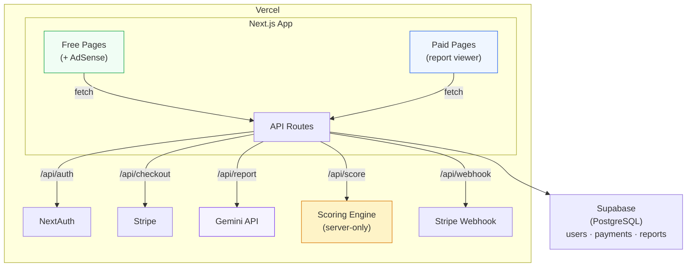

### Option B: React SPA (Vite) + FastAPI Backend (Python)

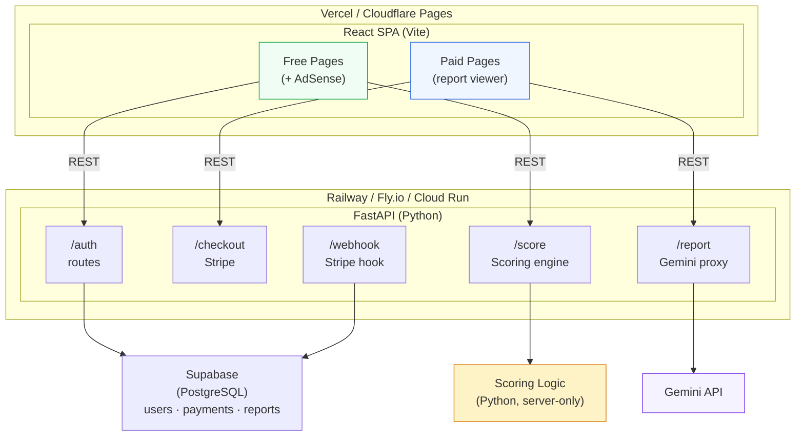

### Option C: React + Expo (Web + Mobile) + FastAPI Backend (Python)

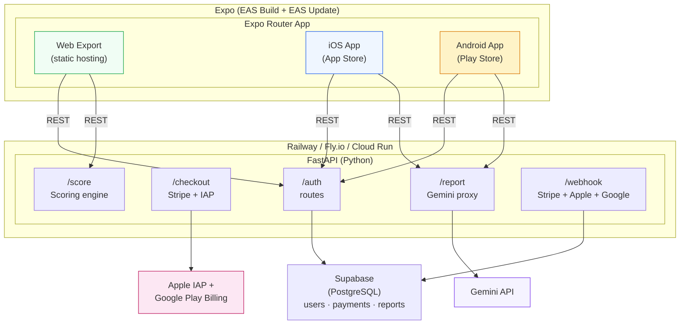

---

## 4. Tech Stack Comparison

### Stack per option

| Layer | A: Next.js Full-Stack | B: React SPA + FastAPI | C: Expo + FastAPI |
|---|---|---|---|
| Frontend | Next.js 15 (React, SSR) | React (Vite, SPA) | Expo (React Native, Web + iOS + Android) |
| Backend | Next.js API Routes (serverless) | FastAPI (Python 3.12, always-on) | FastAPI (Python 3.12, always-on) |
| Language | TypeScript only | TypeScript (FE) + Python (BE) | TypeScript (FE) + Python (BE) |
| Styling | Tailwind CSS | Tailwind CSS | NativeWind (Tailwind for RN) / StyleSheet |
| Charts | Chart.js | Chart.js | `react-native-chart-kit` or `victory-native` |
| Auth | NextAuth.js | FastAPI + PyJWT | FastAPI + PyJWT + Expo AuthSession |
| Payments (Web) | Stripe Checkout | Stripe Checkout | Stripe Checkout |
| Payments (Mobile) | N/A (PWA) | N/A (PWA) | Apple IAP + Google Play Billing |
| Database | Supabase (PostgreSQL) | Supabase + SQLAlchemy | Supabase + SQLAlchemy |
| LLM SDK | `@google/generative-ai` (JS) | `google-generativeai` (Python) | `google-generativeai` (Python) |
| FE Hosting | Vercel | Vercel / Cloudflare Pages | EAS (web export) + App Stores |
| BE Hosting | Vercel (serverless) | Railway / Fly.io / Cloud Run | Railway / Fly.io / Cloud Run |
| Mobile | PWA | PWA | Native (App Store + Play Store) |

### Trade-off matrix

| Criterion | A: Next.js | B: React SPA + FastAPI | C: Expo + FastAPI |
|---|---|---|---|
| **Time to ship** | ⭐⭐⭐⭐⭐ Fastest — one codebase, one deploy | ⭐⭐⭐⭐ Two deploys, but familiar Python BE | ⭐⭐⭐ Slowest — RN quirks, store submissions, IAP integration |
| **Your Python skills** | ⭐⭐ Scoring logic must be in JS/TS | ⭐⭐⭐⭐⭐ Core logic in Python | ⭐⭐⭐⭐⭐ Same Python backend as B |
| **SEO** | ⭐⭐⭐⭐⭐ SSR built-in | ⭐⭐⭐ SPA, needs prerendering | ⭐⭐ React Native Web has poor SEO; need a separate landing site |
| **Infra simplicity** | ⭐⭐⭐⭐⭐ Single Vercel deploy | ⭐⭐⭐ Two services (FE + BE), CORS config | ⭐⭐ Two services + two app stores + OTA updates |
| **Cost at launch** | €0 (Vercel free tier) | ~€5/mo (always-on BE) | ~€104/yr (Apple $99) + ~€5/mo BE + Play Store ($25 one-time) |
| **Revenue per €3.99 sale** | €3.59 (Stripe 2.9%+€0.25, Gemini €0.03) | €3.59 (same) | Web: €3.59 · Mobile: **€2.46** (Apple/Google take 30%) |
| **Mobile UX** | ⭐⭐⭐ PWA — decent, no app icon on home screen by default | ⭐⭐⭐ Same PWA | ⭐⭐⭐⭐⭐ Native feel, push notifications, smooth animations |
| **Scoring / ML extensibility** | ⭐⭐⭐ JS/TS only | ⭐⭐⭐⭐⭐ Python (pandas, numpy, scikit-learn) | ⭐⭐⭐⭐⭐ Same Python backend |
| **Ecosystem / hiring** | ⭐⭐⭐⭐⭐ Largest React + Next.js community | ⭐⭐⭐⭐ Large for both React and FastAPI | ⭐⭐⭐ Smaller Expo/RN pool, fewer web-focused RN devs |
| **Update speed** | Instant (deploy to Vercel) | Instant (FE deploy + BE deploy) | Web: instant · Mobile: 1-7 day App Store review (or OTA for JS-only changes) |
| **Vendor lock-in** | Vercel (medium — can self-host) | Low (standard Docker + static files) | High (Apple/Google app store rules, Expo EAS) |
| **Code sharing FE↔BE** | ⭐⭐⭐⭐⭐ Same language (TS) | ⭐⭐ Different languages, shared via API contracts | ⭐⭐ Same as B |

### Scalability comparison

| Scaling dimension | A: Next.js | B: React SPA + FastAPI | C: Expo + FastAPI |
|---|---|---|---|
| **Frontend** | Vercel CDN, auto-scales to millions | Static CDN, auto-scales to millions | Web: static CDN · Mobile: no FE scaling needed (runs on device) |
| **Backend compute** | Serverless auto-scales per request. Cold starts add 200-500ms latency per function. Max 10s (free) or 60s (pro) execution limit — **Gemini calls may timeout** on free tier. | Single container — vertical scaling first (bump RAM/CPU). Horizontal: add replicas behind a load balancer. No cold starts. **Long-running Gemini calls work fine.** | Same as B |
| **Database** | Supabase free: 500MB, 2 concurrent connections. Paid: $25/mo, scales linearly. | Same | Same |
| **Bottleneck** | Vercel serverless 10s timeout on free tier. Gemini 2.5 Pro responses take 8-30s → **will hit timeout**. Pro plan ($20/mo) raises to 60s. | FastAPI process count. Default 1 worker = ~50 concurrent requests. At scale: add Gunicorn workers or Kubernetes pods. | Same as B + App Store review bottleneck for urgent fixes |
| **Cost at 10K users/mo** | ~€0 (still within Vercel free tier) | ~€5-10/mo (Railway/Fly single instance) | ~€5-10/mo + app store fees amortized |
| **Cost at 100K users/mo** | ~€20/mo (Vercel Pro for timeout) + Supabase $25/mo | ~€25-50/mo (2-3 BE replicas) + Supabase $25/mo | Same as B + stores |
| **Cost at 1M users/mo** | ~€150-300/mo (Vercel Enterprise territory) | ~€100-200/mo (auto-scaling on Cloud Run) | Same as B |
| **Global latency** | Vercel edge = low everywhere | Single region BE = high for distant users. Fix: multi-region deploy or edge cache. | Same as B |

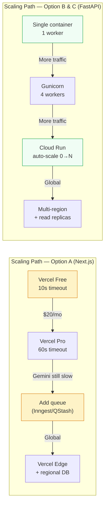

### ⚠️ Key scalability risks

| Risk | Affects | Detail |
|---|---|---|
| **Vercel 10s serverless timeout** | Option A | Gemini 2.5 Pro takes 8-30s. Free tier will timeout. Pro ($20/mo) extends to 60s but adds cost early. |
| **Gemini rate limits** | All options | Free tier: 25 RPD (Pro) / 500 RPD (Flash). At 50+ paid reports/day you need a paid Gemini plan ($0 → pay-as-you-go). |
| **Single-region backend** | B, C | Users far from your BE region get 200-400ms extra latency. Not critical for report generation (already slow), but noticeable for `/score` endpoint. |
| **App Store payment rules** | C only | Apple mandates IAP for digital goods → 30% cut. You cannot use Stripe inside the iOS app for report purchases. Web bypass is possible but risky (Apple has rejected apps for this). |
| **Database connection limits** | All options | Supabase free: 2 connections. Serverless (A) needs connection pooling (PgBouncer). FastAPI (B, C) holds connections per worker — scales more predictably. |

### Verdict

| If you want… | Choose |
|---|---|
| Fastest launch, simplest infra, SEO out of the box | **A: Next.js** |
| Python backend, ML extensibility, your strongest skills | **B: React SPA + FastAPI** ⭐ recommended |
| App Store presence, native mobile UX, push notifications | **C: Expo + FastAPI** |
| Best cost efficiency at scale | **B** (no serverless timeouts, no app store cuts) |
| Minimum viable product then iterate | **B** (deploy web first, add Expo native later if needed) |

**Option B is the sweet spot** for your profile: you get Python for the brain, React for the face, PWA for mobile, and a clean path to add Expo native apps later if App Store distribution becomes strategic.

---

## 5. Competitive Landscape

### No existing tool combines all four core differentiators: (1) quantitative financial analysis, (2) qualitative lifestyle scoring, (3) AI-generated personalized reports, (4) family-composition-aware per-member analysis.

### Head-to-head comparison

| Tool | Type | Price | Quant (financial) | Qual (lifestyle) | Quant + Qual integrated | AI Reports | Family composition | Personal traits / discrimination | Custom weights | City-level granularity |
|---|---|---|---|---|---|---|---|---|---|---|
| **This product** | Interactive comparator | Freemium (€3.99/report) | ✅ Full income/expense modeling, net worth projection | ✅ 10+ weighted parameters | ✅ **Single unified score** | ✅ **Gemini narrative** | ✅ **Per-member profiles** | ✅ **Origin, race, risk tolerance** | ✅ User-defined 1-5 | ✅ Any city |
| **Numbeo** | Crowdsourced DB | Free / API paid | ✅ 50+ price categories | ⚠️ Superficial indices | ❌ Separate tabs | ❌ | ❌ | ❌ | ❌ | ✅ |
| **Expatistan** | Cost comparison | Free | ✅ % difference per category | ❌ | ❌ | ❌ | ❌ | ❌ | ❌ | ✅ |
| **Teleport** | QoL scoring | Free (consumer deprioritized) | ✅ Cost + salary adjust | ✅ 17 dimensions | ⚠️ Closest, but city averages only | ❌ | ❌ | ⚠️ Single "Tolerance" score | ❌ Fixed weights | ✅ |
| **NomadList** | Nomad city rankings | $99 lifetime | ✅ Nomad cost breakdown | ⚠️ Basic scores | ❌ | ❌ | ❌ Solo nomads only | ❌ | ❌ | ✅ |
| **InterNations** | Expat community | €6-12/mo | ⚠️ Survey-based finance | ✅ Settling-in, QoL | ❌ | ❌ | ❌ | ⚠️ Generic "Ease of Settling In" | ❌ | ❌ Country-level only |
| **Niche** | US city/school grading | Free / $39.95/yr | ✅ Letter grades | ✅ Multi-dimension | ⚠️ Grades, not modeling | ❌ | ❌ | ❌ (has diversity data, doesn't personalize) | ❌ | ✅ US only |
| **Mercer** | Enterprise CoL survey | $10K-50K/yr (B2B) | ✅ 200+ items, gold standard | ✅ 39-factor QoL | ❌ Separate products | ❌ Static PDF | ⚠️ 3 buckets (single/couple/family) | ❌ | ❌ | ✅ 500+ cities |
| **ECA International** | Enterprise mobility | $5K-30K/yr (B2B) | ✅ Full tax + CoL | ⚠️ Hardship ratings | ❌ | ❌ | ⚠️ 3 buckets | ❌ | ❌ | ✅ |
| **Wise** | SEO content (transfer service) | Free | ⚠️ Basic averages | ❌ | ❌ | ❌ | ❌ | ❌ | ❌ | ⚠️ Country-level |
| **MoveBuddha** | Moving logistics (US) | Free (lead-gen) | ⚠️ SEO content pages | ❌ | ❌ | ❌ | ❌ | ❌ | ❌ | ✅ US only |
| **Homeis** | Immigrant community app | Free (possibly defunct) | ❌ | ❌ | ❌ | ❌ | ❌ | ⚠️ Origin-aware community | ❌ | ⚠️ Major US cities |
| **Raw ChatGPT/Claude** | General LLM | Free / $20/mo | ❌ No structured input | ❌ No scoring framework | ❌ | ⚠️ Narrative but no consistent format | ❌ User must describe manually | ⚠️ If user provides context | ❌ | ❌ |

### Market gap summary

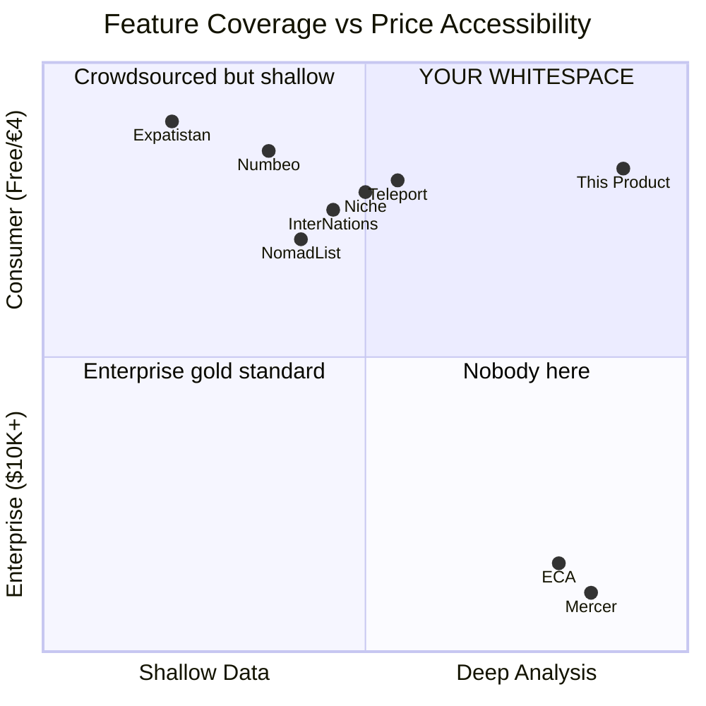

### Why this product wins

| Advantage | Detail |
|---|---|
| **Only integrated quant + qual tool** | Competitors separate finance from lifestyle. This product unifies them into one weighted score. |
| **Only AI-powered narrative** | Zero competitors generate personalized AI reports. Mercer/ECA use human analysts at $10K+. |
| **Only family-aware tool** | No competitor asks about partner profession, kid ages, or per-member needs. |
| **Only origin/trait-aware tool** | No competitor personalizes integration/discrimination risk by ethnicity or origin. |
| **Price gap filler** | Free tools are shallow. Enterprise tools cost $10K+. €3.99 fills the gap. |
| **User brings their own data** | No dependency on stale crowdsourced data — user inputs real numbers. |

### Risks to acknowledge

| Risk | Detail |
|---|---|
| **Sensitivity of discrimination analysis** | No competitor touches this for legal/ethical reasons. Needs careful framing: "community integration factors" not "racism scores." Source from OECD/EU data, not AI opinions. |
| **Data cold start** | Unlike Numbeo (crowdsourced) or Mercer (analysts), user must research their own numbers. Consider pre-filling from Numbeo API to reduce friction. |
| **LLM as competitor** | Users can paste data into ChatGPT directly. Your value: structured input framework, consistent output format, financial charts, scoring methodology. |
| **Teleport is closest** | But deprioritized since Topia acquisition (enterprise pivot). Good timing. |

---

## 6. FastAPI Backend Structure (Option B detail)

```
backend/
├── app/
│   ├── main.py              # FastAPI app, CORS, lifespan
│   ├── config.py            # pydantic-settings (env vars)
│   ├── dependencies.py      # get_current_user, get_db
│   ├── models/
│   │   ├── user.py           # SQLAlchemy models
│   │   ├── report.py
│   │   └── payment.py
│   ├── schemas/
│   │   ├── scoring.py        # Pydantic request/response
│   │   ├── report.py
│   │   └── family.py
│   ├── routers/
│   │   ├── auth.py           # POST /auth/login, /auth/register
│   │   ├── score.py          # POST /score  (free tier)
│   │   ├── report.py         # POST /report (paid tier, Gemini proxy)
│   │   ├── checkout.py       # POST /checkout/session
│   │   └── webhook.py        # POST /webhook/stripe
│   ├── services/
│   │   ├── scoring.py        # ← YOUR CORE IP (scoring formula)
│   │   ├── prompt_builder.py # ← YOUR CORE IP (prompt engineering)
│   │   ├── gemini.py         # Gemini API client
│   │   └── stripe.py         # Stripe helpers
│   └── utils/
│       └── currency.py       # Exchange rate fetcher
├── requirements.txt
├── Dockerfile
└── .env
```

---

## 6. IP Protection Strategy

### The threat

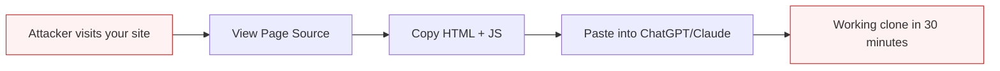

### Defense layers

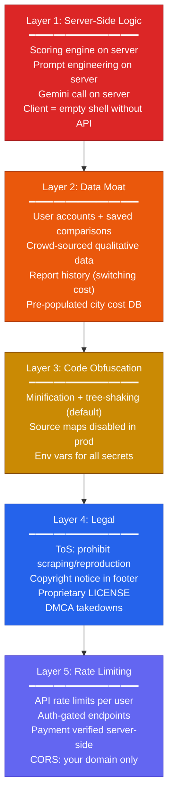

### Impact on clonability

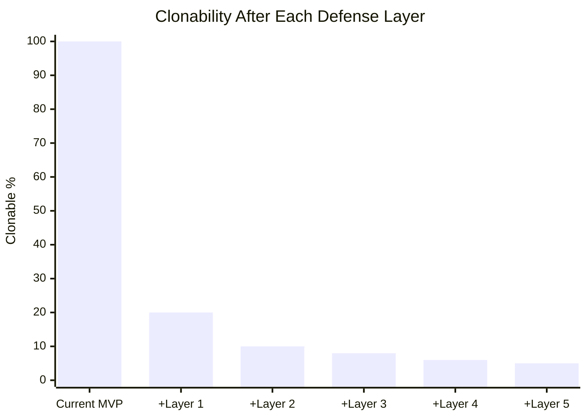

**Layer 1 is the only one that matters.** The rest are incremental.

### What moves server-side

| Component | Current | Target | IP Value |
|---|---|---|---|
| Data entry UI | Client | **Client** | None |
| Scoring formula | Client | **Server** | 🔴 Core IP |
| Prompt builder | Client | **Server** | 🔴 Core IP |
| Gemini API call | Client | **Server** | 🔴 Key protection |
| Report renderer | Client | **Client** | Low |
| Qualitative UI | Client | **Client** | None |
| Weight computation | Client | **Server** | 🟡 Medium |
| Family CRUD | Client | **Client** | None |
| API key (config.js) | Client | **Server** | 🔴 Must hide |

---

## 8. User Flow & UX Design

### Design decisions

| Decision | Choice | Rationale |
|---|---|---|
| Entry mode | Decision mode first (user knows cities). Discovery mode later. | MVP scope. Discovery needs a city database + matching algorithm. |
| Data source | Pre-fill from Numbeo/APIs. User adjusts. | Reduces friction from ~30 min manual research to ~5 min review. |
| Free report | Summary only (scores + podium). Detailed breakdown is paid. | Enough to build trust. "Why" is the paid value. |
| Questionnaire | Full guided flow, ~5-8 min, 25-35 questions, 5-6 pages. | Deeper data = better report. Section-per-page keeps focus. |
| Priorities | Tier buckets: Dealbreaker / Important / Nice-to-have. | Faster than 1-5 sliders. Forces real trade-offs. |
| Qualitative data | Pre-fill from public data (crime indices, school rankings, climate). User overrides. | Balance between accuracy and speed. |
| Wizard UI | Section-per-page, progress bar. Guided first time, free-nav on return. | Clear, predictable. Returning users skip to what they want. |
| City selection | Structured: "Current home" + "Add 1-5 candidate cities". | Clear current-vs-candidate distinction. |
| Paywall | Tease the "why" — scores visible, explanation locked. | User invested 5-8 min. Curiosity gap drives conversion. |
| Account | Optional. Asked at report time with clear value prop. User can refuse → report sent by email. | No friction upfront. Account earns its place (history, iterations, caching). |
| Report delivery | Async generation (15-30s loading) → permanent shareable URL. Email copy. PDF download. | Feels premium. Bookmarkable. Shareable with partner. |
| Iterations | Flexible: €3.99/report or bundle (e.g. €9.99/3 reports). Free summary always refreshes for free. | Encourages experimentation without unlimited AI cost exposure. |
| Device | Mobile-first, responsive up to desktop. | Consumer product. Most traffic will be mobile. |

### Full user journey

```mermaid
flowchart TD
    LAND(["🌍 User lands on site"]) --> HERO["Landing page<br/>Value prop + CTA: 'Compare cities'"]

    HERO --> MODE{"'Do you know which<br/>cities to compare?'"}
    MODE -->|"Yes"| P1
    MODE -->|"Not sure"| DISC["🔮 Discovery Mode<br/>(Phase 2 — not MVP)"]

    subgraph WIZARD ["📋 Questionnaire Wizard (5-6 pages)"]
        direction TB
        P1["PAGE 1: Your Family<br/>━━━━━━━━━━━━━━━━━━<br/>• Members (name, age, gender,<br/>  profession, origin)<br/>• Current city<br/>• Add 1-5 candidate cities<br/>• Autocomplete + city preview cards"]

        P2["PAGE 2: Your Priorities<br/>━━━━━━━━━━━━━━━━━━<br/>• Drag factors into 3 buckets:<br/>  🔴 Dealbreaker<br/>  🟡 Important<br/>  🟢 Nice-to-have<br/>• Factors: Safety, Schools, Cost,<br/>  Healthcare, Weather, Food,<br/>  Career, Family proximity,<br/>  Integration, Culture"]

        P3["PAGE 3: Financial Data<br/>━━━━━━━━━━━━━━━━━━<br/>• Per city: Income (him + her),<br/>  Rent, Childcare, Food,<br/>  Transport, Other<br/>• PRE-FILLED from Numbeo API<br/>• User adjusts known values<br/>• 'I don't know' keeps estimate<br/>• Currency auto-detected per city"]

        P4["PAGE 4: Lifestyle Ratings<br/>━━━━━━━━━━━━━━━━━━<br/>• Per city × per factor<br/>  (only Dealbreaker + Important)<br/>• PRE-FILLED from public data<br/>  (crime index, school rank,<br/>   climate score, etc.)<br/>• User overrides with 4-level<br/>  rating: Top / Medium / Low / Critical<br/>• Optional notes per cell"]

        P5["PAGE 5: Personal Context<br/>━━━━━━━━━━━━━━━━━━<br/>• Family support network per city<br/>  (visits/yr, cost/trip, extra help)<br/>• Risk tolerance per adult member<br/>• Race / origin (for integration<br/>  analysis — optional, explained)<br/>• Quant/Qual weight slider<br/>• Any other notes for the AI"]

        P6["PAGE 6: Review & Generate<br/>━━━━━━━━━━━━━━━━━━<br/>• Summary of all inputs<br/>• Edit any section (jump back)<br/>• 'Generate Free Summary' button"]

        P1 --> P2 --> P3 --> P4 --> P5 --> P6
    end

    P6 --> FREE_REPORT

    subgraph CONVERSION ["💰 Conversion Funnel"]
        direction TB
        FREE_REPORT["FREE SUMMARY<br/>━━━━━━━━━━━━━━━━━━<br/>• City scores (7.2 / 6.8 / 5.1)<br/>• Podium ranking 🥇🥈🥉<br/>• Net savings per city<br/>• Basic bar chart<br/>• NO explanation of WHY"]

        TEASE["TEASE BLOCK<br/>━━━━━━━━━━━━━━━━━━<br/>'Your scores are ready.<br/>Want to know WHY Florence<br/>beats Manchester for your family?'<br/><br/>• Preview: section titles of<br/>  AI report (blurred content)<br/>• '2,847 families analyzed'<br/>• CTA: 'Get Full Report — €3.99'<br/>• Alt: '3 reports for €9.99'"]

        FREE_REPORT --> TEASE
    end

    TEASE -->|"Clicks CTA"| ACCOUNT

    subgraph PAYMENT ["🔐 Account + Payment"]
        direction TB
        ACCOUNT{"'Save your reports<br/>for later?'"}
        ACCOUNT -->|"Yes — create account"| SIGNUP["Email + magic link<br/>(no password)"]
        ACCOUNT -->|"No thanks"| EMAIL_ONLY["'Email for report delivery'<br/>(one field)"]
        SIGNUP --> STRIPE
        EMAIL_ONLY --> STRIPE
        STRIPE["Stripe Checkout<br/>€3.99 or €9.99 bundle"]
    end

    STRIPE -->|"Payment success"| GENERATING

    subgraph REPORT_DELIVERY ["📊 Report Delivery"]
        direction TB
        GENERATING["⏳ 'Preparing your report...'<br/>15-30s loading animation<br/>Show: 'Analyzing financial data...'<br/>'Scoring lifestyle factors...'<br/>'Writing personalized insights...'"]
        REPORT_PAGE["FULL AI REPORT<br/>━━━━━━━━━━━━━━━━━━<br/>• Permanent URL /report/abc123<br/>• Executive summary<br/>• Per-city deep analysis<br/>• Per-member personal fit<br/>• Cross-parameter insights<br/>• Financial projections<br/>• Final recommendation<br/>• PDF download button<br/>• 'Share with partner' link"]

        GENERATING --> REPORT_PAGE
    end

    REPORT_PAGE --> ITERATE{"Change inputs<br/>& re-run?"}
    ITERATE -->|"Has credits"| P1
    ITERATE -->|"No credits"| TEASE

    style LAND fill:#e0e7ff,stroke:#4338ca
    style HERO fill:#e0e7ff,stroke:#4338ca
    style FREE_REPORT fill:#f0fdf4,stroke:#16a34a
    style TEASE fill:#fef9c3,stroke:#ca8a04
    style STRIPE fill:#eff6ff,stroke:#2563eb
    style GENERATING fill:#f5f3ff,stroke:#7c3aed
    style REPORT_PAGE fill:#f0fdf4,stroke:#16a34a
    style DISC fill:#f1f5f9,stroke:#94a3b8
```

### Page-by-page data map

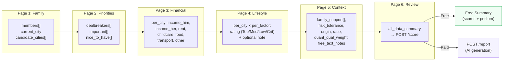

### Returning user flow

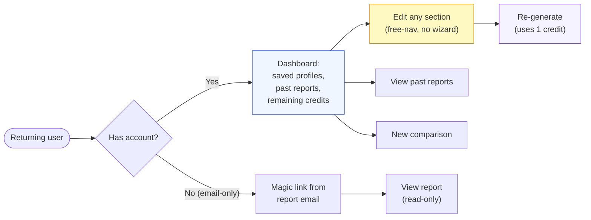

### Mobile-first wireframe structure

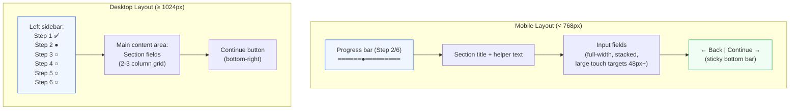

### Pricing model

| Option | Price | Credits | Cost per report | Best for |
|---|---|---|---|---|
| Single report | €3.99 | 1 | €3.99 | One-time decision |
| 3-report bundle | €9.99 | 3 | €3.33 | Couples iterating together |
| 5-report bundle | €14.99 | 5 | €3.00 | Power users, multiple scenarios |

Free summary (scores + podium) always regenerates for free. Credits are consumed only when generating a full AI report.

---

## 8. Data Model

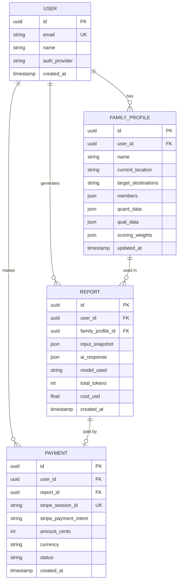

---

## 9. API Endpoints

| Method | Path | Auth | Tier | Description |
|---|---|---|---|---|
| `POST` | `/auth/register` | — | — | Create account |
| `POST` | `/auth/login` | — | — | Get JWT |
| `GET` | `/auth/me` | ✅ | — | Current user |
| `POST` | `/score` | — | Free | Compute scores from raw inputs |
| `POST` | `/report` | ✅ | Paid | Generate AI report (checks payment) |
| `GET` | `/report/{id}` | ✅ | Paid | Retrieve saved report |
| `GET` | `/reports` | ✅ | Paid | List user's report history |
| `POST` | `/checkout/session` | ✅ | — | Create Stripe Checkout session |
| `POST` | `/webhook/stripe` | — | — | Stripe payment confirmation |
| `GET` | `/currency/rates` | — | Free | Exchange rates (cached) |

---

## 10. Migration Phases

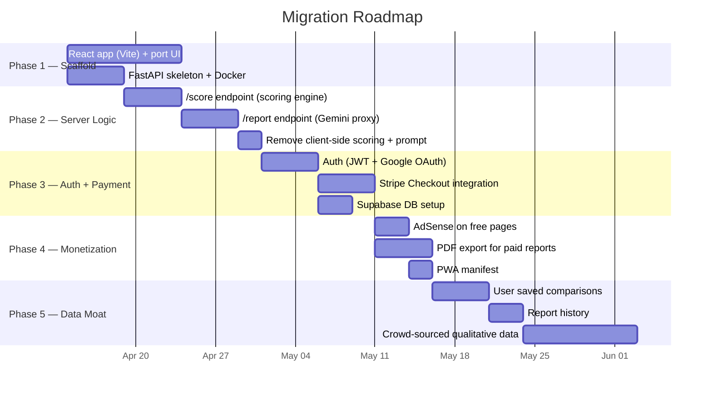

---

## 11. SEO Strategy (critical for organic acquisition)

People search: _"should I move from UK to Italy"_, _"cost of living Manchester vs Florence"_, _"relocation calculator"_.

| Tactic | Implementation |
|---|---|
| **SSR / Prerendering** | Next.js SSR by default, or Vite + `vite-plugin-ssr` / prerender for FastAPI option |
| **Landing pages** | `/compare/london-vs-rome`, `/compare/london-vs-padova` — statically generated |
| **Blog / content** | `/blog/cost-of-living-uk-vs-italy-2025` — SEO magnet, links to tool |
| **Schema.org markup** | `FAQPage`, `HowTo` structured data |
| **Meta tags** | Open Graph + Twitter Cards for social sharing |
| **Sitemap** | Auto-generated, submitted to Google Search Console |

---

## 12. Monitoring & Analytics

| What | Tool | Cost |
|---|---|---|
| Error tracking | Sentry (free tier) | €0 |
| Analytics | Plausible or Vercel Analytics | €0–9/mo |
| Uptime | UptimeRobot (free) | €0 |
| API performance | FastAPI built-in `/docs` + logging | €0 |
| Stripe dashboard | Stripe (built-in) | €0 |
| LLM cost tracking | Custom: log tokens per report to DB | €0 |

---

## 13. Risk Matrix

| Risk | Likelihood | Impact | Mitigation |
|---|---|---|---|
| LLM clone from source | High (now) | High | Layer 1: server-side logic |
| Gemini API cost spike | Low | Medium | Budget alerts, model fallback chain (already built) |
| Low conversion free→paid | Medium | High | A/B test pricing, show blurred preview of AI report |
| Stripe fees eat margin | Low | Low | €3.99 − €0.37 (Stripe) − €0.03 (Gemini) = €3.59 net |
| Competitor with more data | Medium | Medium | Data moat, move fast |
| SEO penalty (SPA, no SSR) | Medium (FastAPI option) | Medium | Prerendering + landing pages |
| Backend downtime | Low | High | Health checks, auto-restart, Railway/Fly.io HA |
| GDPR compliance | Medium | High | Data stored in EU (Supabase EU region), privacy policy, cookie consent, data deletion endpoint |

---

## 14. GDPR & Privacy Checklist

| Requirement | Implementation |
|---|---|
| Privacy Policy page | `/privacy` — what data is collected, how it's used |
| Cookie consent banner | Only needed if using AdSense / analytics cookies |
| Data deletion | `DELETE /auth/me` → deletes user + all reports + payments |
| Data export | `GET /auth/me/export` → JSON dump of all user data |
| Data residency | Supabase EU region (Frankfurt) |
| Minimal data collection | No tracking beyond essential analytics |
| Stripe PCI compliance | Stripe Checkout handles all card data (never touches your server) |
