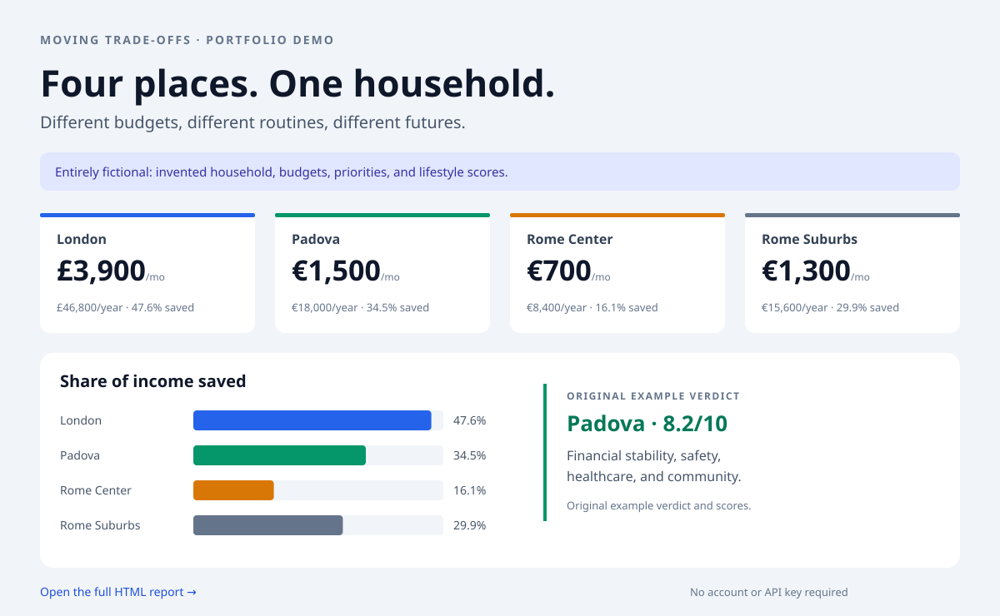

# Moving Trade-offs

**A relocation decision tool that connects household budgets with lifestyle priorities.** Built with vanilla JavaScript, Chart.js, and an optional Gemini integration.

### [Try the interactive website →](https://albertocutone.github.io/moving-trade-offs/)

### [Read the sample HTML report →](https://albertocutone.github.io/moving-trade-offs/example-report.html)

[](https://albertocutone.github.io/moving-trade-offs/example-report.html)

*Click the preview to open the full report. GitHub READMEs cannot embed a live HTML page; the report is hosted on GitHub Pages and supports printing or saving as PDF.*

## The idea

A move changes more than rent. This project brings income, expenses, childcare, family support, and personal priorities into one comparison. Edit the demo, explore the charts, adjust the weights, and optionally generate a narrative report.

All default names, ages, professions, budgets, ratings, and the sample report describe an **invented household**. Cities are real; the demo figures and qualitative descriptions are illustrative, not researched estimates.

## What you can try

- Edit household members and their priorities, traits, hobbies, and notes.
- Compare four scenarios: Manchester, Bologna, Florence Center, and Florence Suburbs.
- Calculate monthly/yearly savings, expense breakdowns, and multi-year projections.
- Convert EUR, GBP, USD, and CHF using live exchange rates, with fallback rates when unavailable.
- Explore weighted lifestyle ratings and family-support costs.
- Generate a Gemini report with your own API key, or copy a prompt for another AI tool.
- Download a generated report as HTML; print the standalone sample report as PDF.
- Keep inputs between visits using local browser storage, with a clear-data control.

## Implementation

No framework, build step, account, or application backend. The UI uses HTML, Tailwind via CDN, and small JavaScript components loaded in dependency order.

```text
index.html                 Interactive explorer
example-report.html        Standalone fictional report
css/styles.css             Custom styles
js/
  app.js                   Startup and component wiring
  calculator.js            Financial calculations and updates
  charts.js, podium.js     Charts and ranking visualizations
  currency.js              Exchange rates and conversions
  family.js, qualitative.js Profile editing and lifestyle ratings
  prompt.js, llm.js         Prompt construction and Gemini requests
  report.js                Report rendering and HTML export
  cache.js                 Local input persistence
  example-report.js        Lazy loading of the sample report
scripts/audit_public.py    Credential and identifier scan
```

The financial calculations run locally. Gemini returns structured JSON for narrative sections; the browser renders it alongside the calculated budget data. The original sample report is static and needs no AI call. It retains its fictional London, Padova, and Rome scenarios, which differ from the explorer’s current defaults.

[DESIGN.md](DESIGN.md) explores a future commercial architecture. It is a design proposal; payments, authentication, and a server API are not implemented.

## Run locally

```bash
python3 -m http.server 8000
```

Open [localhost:8000](http://localhost:8000). Internet access is needed for CDN resources and live exchange rates. Comparisons and the sample report require no API key.

## Optional Gemini setup and privacy

1. Create your own key in [Google AI Studio](https://aistudio.google.com/apikey).
2. Paste it into the password field in the explorer.
3. Select **Generate Report** when you are ready to send your inputs to Gemini.

The app contains no shared key. Keys stay in the current page's memory, are not saved in browser storage, and are sent to Google in the `x-goog-api-key` header. Reloading clears the key. Legacy keys saved by earlier versions are removed at startup.

Inputs are stored locally in your browser. **Generating a report sends household and comparison data to Google Gemini.** Copying a prompt lets you review it before sharing it with an AI provider. CDN assets and exchange rates also use external services. Use the clear-data control to remove saved inputs.

Never put credentials in source files or GitHub Pages. Local environment/configuration files are ignored. To check the public tree and history:

```bash
python3 scripts/audit_public.py --history
```

GitHub Actions runs this audit and JavaScript syntax checks on pushes and pull requests. The audit checks common credential formats and removed identifiers, allowing the original report’s fictional names; it cannot detect every possible secret. Revoke exposed keys at the provider: rewriting Git history does not invalidate them or remove copies held in forks, caches, or other clones.

## Deployment

GitHub Pages serves `main` from the repository root. The live explorer is `index.html`; the report is `example-report.html`. A `.nojekyll` file keeps the site static. The repository history was replaced with a single anonymized portfolio commit.

## Current scope

City scenarios are fixed, qualitative defaults are illustrative, and AI output can vary. This is a portfolio prototype for exploring decisions, not an authoritative relocation recommendation service.

## License

No open-source license has been selected. This repository is shared for portfolio review.
