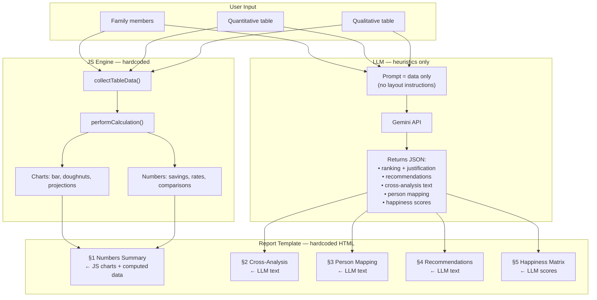
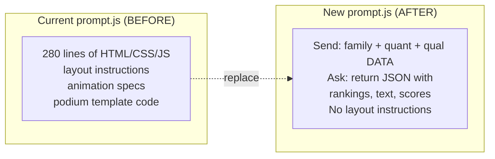

> **Historical implementation plan.** The current demo keeps visitor API keys in memory and sends them in a request header. See README.md for current setup and privacy behavior.

## Context

The current `prompt.js` asks the LLM to generate a full self-contained HTML report (layout, CSS, JS, animations). This is wasteful and unpredictable — the report template already exists in `example-report.html`. The LLM should only return **structured JSON** with heuristic/qualitative content. The hardcoded JS fills the template with both computed data and LLM output.

## Architecture

---

## Phase 1: Remove "Calculate & Update Analysis" button
- Delete button from `index.html` (~line 447–451)
- Auto-trigger `performCalculation()` on input changes (debounced)
- Remove blur overlays — charts render immediately

## Phase 2: Rewrite the prompt
- Strip all HTML/CSS/JS generation instructions from `buildPromptText()`
- Keep the data collection (family, quant, qual) — that stays
- New prompt says: "Analyze this data. Return a JSON object with these keys:" and defines the schema (ranking, justification, recommendations, cross-analysis, person-mapping, happiness-scores)
- The LLM returns **JSON only**, not HTML

## Phase 3: Add Gemini API client
- Create `js/llm.js` — calls `https://generativelanguage.googleapis.com/v1beta/models/gemini-2.0-flash:generateContent`
- API key input field in UI, held in memory only
- "Generate Report" button replaces "Generate Prompt" + clipboard flow

## Phase 4: Build the report renderer
- Create `js/report.js` — takes the hardcoded template (based on `example-report.html`) and populates it:
  - **Numbers Summary**: filled by JS (computed savings, rates, charts moved here)
  - **Cross-Analysis, Person Mapping, Recommendations, Happiness Matrix**: filled from LLM JSON response
- Renders inline in the page where the current AI Report section is

---

## Gemini API Key — Setup

1. Go to [Google AI Studio → API Keys](https://aistudio.google.com/apikey)
2. Click **"Create API Key"**
3. Select or create a Google Cloud project
4. Copy the key (format: `AIza...`)
5. Paste it into the app's API key field (held in memory only)
6. The app calls: `POST https://generativelanguage.googleapis.com/v1beta/models/gemini-2.0-flash:generateContent` with the `x-goog-api-key` request header
7. **Later (cloud)**: move the key server-side, swap the URL to your proxy endpoint

---

## Files

| File | Action |
|------|--------|
| `index.html` | Remove calc button + overlays, add API key input, add report container |
| `js/prompt.js` | Rewrite: keep data collectors, new prompt asks for JSON output only |
| `js/llm.js` | **New** — Gemini API client |
| `js/report.js` | **New** — fills hardcoded template with JS data + LLM JSON |
| `js/calculator.js` | Add auto-trigger on input change |
| `js/app.js` | Wire new modules |